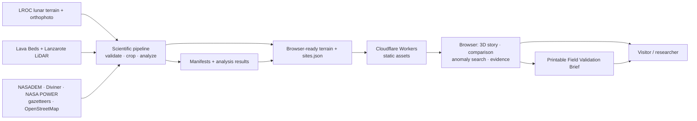

# Analog Blindspot

<p align="center">
  
</p>

<p align ="center">
  
  
  
  
  
</p>

**Analog Blindspot** turns lunar and Earth terrain data into an interactive investigation of what orbital maps miss and where researchers could look next.

- **Deployed Project:** [analog-blindspot.ryanlau1220.workers.dev](https://analog-blindspot.ryanlau1220.workers.dev/)
- **Live Demo:** [Watch the demo video on YouTube](https://youtu.be/QeMeyhgntPg)
- **Pitch Deck:** [View the seven-slide PDF](submission/Analog-Blindspot_Pitch-Deck.pdf)
- **Submission materials:** [Video, transcript and sources](submission/SUBMISSION.md)

<p align="center">
  <a href="https://youtu.be/QeMeyhgntPg">
    
  </a>
  <br />
  <a href="https://youtu.be/QeMeyhgntPg">Watch the demo video on YouTube</a>
</p>

**Team:** Machine Not Learning · **Team member:** Ryan Lau Jun Hong

**Challenge:** [Identify Earth Locations that Analog the Permanent Moon Base Locations and Mars](https://www.spaceappschallenge.org/2026/challenges/permanent-moon-base-locations-and-mars/)

> This is a research and education prototype. Its highlighted terrain anomalies are **unverified leads**, not confirmed caves or newly validated analog sites. It does not measure subsurface geometry, establish habitability, analyze Martian elevation, or recommend a validated Moon or Mars base site.

## Table of Contents

- [Project Overview](#project-overview)
- [Installation & Setup](#installation--setup)
- [Project Structure](#project-structure)
- [System Architecture](#system-architecture)
- [Tech Stack](#tech-stack)
- [Core Features](#core-features)
- [Essential Commands](#essential-commands)
- [Data, Findings & Limitations](#data-findings--limitations)
- [References](#references)

## Project Overview

Marius Hills Pit is visible in lunar imagery, but a visible opening is not a map of what lies beneath it. Analog Blindspot starts with the missing elevation in a real lunar terrain model, then uses two established volcanic regions on Earth to explore how terrain resolution changes the evidence available to a researcher.

1. **Observe the blind spot:** inspect the measured surface and the missing-elevation region at Marius Hills Pit.
2. **Investigate Earth analogs:** compare observed LiDAR and simulated coarser terrain at Lava Beds and Lanzarote.
3. **Explore research leads:** examine a terrain-relief search and its independent mapped-entrance cross-check.
4. **Plan verification:** review the evidence and produce a printable Field Validation Brief.

The Earth sites are already known analog environments; the new anomaly flags require field or other independent verification. See [Data, Findings & Limitations](#data-findings--limitations) before interpreting the results.

## Installation & Setup

### Prerequisites

- [Node.js](https://nodejs.org/) **24.14.0**, as pinned in [`.node-version`](.node-version), and [pnpm](https://pnpm.io/) **12.16.1**, as pinned in [`package.json`](package.json).
- A WebGL-capable browser. Chrome or Chromium is required for the browser smoke and performance scripts.
- Optional for rebuilding the scientific data: Python **3.12 or later** and [`uv`](https://docs.astral.sh/uv/).

### Run the application

```bash
git clone https://github.com/ryanlau1220/Analog-Blindspot.git
cd Analog-Blindspot
pnpm install --frozen-lockfile
pnpm dev
```

Open [http://localhost:5173](http://localhost:5173). The application uses the committed assets in `apps/web/public/data/`; running it requires neither API keys nor the original large rasters. A WebGL-capable device is needed for the 3D view. Open `/#brief` for the printable brief.

### Rebuild scientific assets

The reproducible pipeline requires the source rasters, additional disk space and network access for inputs not already cached. The Lanzarote CNIG tile requires a manual download and licence step. See [Science notes: reproduction](docs/science.md#reproduction) for the exact order, expected path, caching and limitations.

### Deployment

The static build is deployed to Cloudflare Workers using [`wrangler.jsonc`](wrangler.jsonc). [GitHub Actions](.github/workflows/ci-deploy.yml) validates pull requests and `main` pushes; an eligible current `main` run deploys and checks production files. Configure `CLOUDFLARE_API_TOKEN` and `CLOUDFLARE_ACCOUNT_ID` as GitHub Actions repository secrets. They are needed for deployment, not local app use. Avoid running a second automatic Cloudflare Git deployment for the same Worker.

## Project Structure

```text
Analog-Blindspot/
├── apps/web/
│   ├── public/data/        # Committed browser-ready terrain and site data
│   ├── src/                # React UI, story, 3D scene, terrain and audio
│   └── scripts/            # Browser smoke, performance and screenshot tools
├── scientific/
│   ├── config/             # Source definitions, cached inputs and landmarks
│   ├── src/                # Data acquisition, analysis and web export
│   └── tests/              # Scientific pipeline tests
├── datasets/
│   ├── manifest*.json      # Provenance, analysis results and gate checks
│   └── previews/           # Committed reference images
├── docs/                   # Science and interaction documentation
├── submission/             # Demo video, pitch deck and submission notes
├── .github/workflows/      # Validation and deployment workflow
└── wrangler.jsonc          # Cloudflare static asset configuration
```

Large raw inputs and derived rasters under `datasets/raw/` and `datasets/derived/` are ignored by Git; the application-ready data and manifests are committed.

## System Architecture



Data processing happens before deployment. The browser reads the exported files from the same origin; it does not query the source agencies or a project backend at runtime. NASADEM is an independent observed comparison, while the coarsened Earth grids are simulations.

## Tech Stack

| Area | Technology | Purpose |
| --- | --- | --- |
| Interface | React, TypeScript, Vite, Tailwind CSS | Application, controls and responsive layout |
| 3D and motion | Three.js, React Three Fiber, Drei, GSAP | Terrain rendering, camera and presentation motion |
| Scientific processing | Python, NumPy, Rasterio, pyproj, Shapely | Raster processing, coordinate transforms and terrain analysis |
| Data and delivery | JSON, binary height grids, WebP, Cloudflare Workers | Browser-ready assets and static hosting |
| Quality and automation | Vitest, Biome, Playwright, pytest, GitHub Actions | Checks, browser tests and deployment |

## Core Features

- **Interactive lunar terrain:** explore the LROC model and see where elevation data ends; the hatched subsurface is unmeasured.
- **Judge presentation:** an approximately 90-second, six-stage flow from the lunar question through the resolution experiment, search region, featured lead and next investigation. Pause, navigate or exit to the full experience.
- **Guided story and exploration:** five chapters, a scroll journey, interactive terrain controls, site selection and deep links.
- **Resolution experiment:** compare observed Earth LiDAR with computed, block-averaged grids using a draggable split and a reveal sweep. Results are relief statistics, not cave-detection rates.
- **Anomaly investigation:** show high-relief clusters and a separate OpenStreetMap cave-entrance proximity check. The featured Lava Beds lead is tied to its recorded coordinates and remains unverified.
- **Evidence and field decision:** inspect source links, limitations and statistics, compare the two Earth sites, and print or save the Field Validation Brief.
- **Accessible presentation controls:** collapsible story and chapter panels, keyboard-operable controls, reduced-motion support and optional locally synthesized ambient audio that starts only when requested.

See [Story and interaction guide](docs/storytelling.md) for controls and [Science notes](docs/science.md) for methods and provenance.

## Essential Commands

Run from the repository root unless stated otherwise.

| Command | Purpose |
| --- | --- |
| `pnpm install --frozen-lockfile` | Install the pinned JavaScript dependencies |
| `pnpm dev` | Start the local Vite server |
| `pnpm test` | Run web unit tests |
| `pnpm check` | Run Biome and TypeScript checks |
| `pnpm build` | Build static assets into `apps/web/dist/` |
| `pnpm --filter web smoke` | Run desktop, mobile and slow-frame browser smoke tests against the build |
| `pnpm perf` | Run the browser performance smoke test |
| `pnpm exec wrangler deploy --dry-run` | Validate the Cloudflare deployment configuration without deploying |
| `cd scientific && uv sync && uv run pytest` | Install Python dependencies and run scientific tests; data-dependent tests require the raw inputs |

The smoke and performance scripts default to `/usr/bin/google-chrome`; set `CHROME=/path/to/chrome` if needed. For hosting under a subpath, set `BASE_PATH`, for example `BASE_PATH=/analog-blindspot/ pnpm build`.

## Data, Findings & Limitations

| Input / result | What it contributes | Important boundary |
| --- | --- | --- |
| LROC NAC DTM, Marius Hills Pit | A 4 m lunar terrain model and observed pit surroundings | The pit interior contains missing elevation; the model does not map a cave or its safety. |
| Lava Beds LiDAR | Observed 0.5 m Earth terrain and eight approximate GNIS natural-bridge points | At simulated 10 m, point median relief is about 4.3 m versus 4.7 m for sampled background; this is not a detection benchmark. |
| Lanzarote CNIG MDT02 | Observed 2 m terrain and six approximate jameo/cave points | The site is a known analog; the land-filtered background and coarse-grid limits matter. |
| Lattice search and OpenStreetMap | At observed Lava Beds resolution: 3,364 sampled locations, 169 top-relief points, and 24 unverified clusters away from named points | Five of 16 mapped cave entrances are within 45 m of a flagged point, versus about 15% of seeded random positions. This preliminary proximity check does not establish cave-detection accuracy. |
| NASADEM and Diviner | An independent 30 m Earth elevation comparison and lunar thermal context | Broad-terrain agreement does not establish feature-level equivalence. The Diviner bin includes the pit's surroundings, not its interior. |
| Mars literature | Context for published Arsia Mons skylight candidate sizes | The prototype does not analyze Martian elevation data. |

The featured anomaly has 17.51 m local relief within a 30 m radius in the observed Lava Beds grid. High relief can also arise from roads, scarps, cliffs or other surface features. A field survey and independent imagery would be needed to assess it. See [Science notes](docs/science.md) and the [Phase E manifest](datasets/manifest_phase_e.json) for the method, checks and uncertainty.

## References

- **Lunar terrain:** [LROC NAC DTM MARIUSPIT01](https://data.lroc.im-ldi.com/lroc/view_rdr_product/NAC_DTM_MARIUSPIT01), NASA/GSFC/Arizona State University.
- **Lava Beds LiDAR:** Williams (2024), NCALM / OpenTopography, [doi:10.5069/G9ST7N19](https://doi.org/10.5069/G9ST7N19), CC BY 4.0; NSF EAR-2324629.
- **Lanzarote terrain:** [CNIG MDT02, second coverage](https://centrodedescargas.cnig.es/CentroDescargas/catalogo.do?Serie=MDT02). Attribution: Obra derivada de MDT02-cob2 2015-2021 CC-BY 4.0 scne.es.
- **NASADEM:** NASA JPL (2020), [NASADEM Merged DEM Global 1 arc second V001](https://doi.org/10.5067/MEaSUREs/NASADEM/NASADEM_HGT.001).
- **Lunar temperature context:** LRO Diviner Global Cumulative Product and Williams et al. (2017), [doi:10.1016/j.icarus.2016.08.012](https://doi.org/10.1016/j.icarus.2016.08.012).
- **Earth locations and context:** USGS GNIS, IGN NGBE, [OpenStreetMap contributors](https://www.openstreetmap.org/copyright) (ODbL), and [NASA POWER](https://power.larc.nasa.gov/).
- **Mars context:** Cushing et al. (2007), [doi:10.1029/2007GL030709](https://doi.org/10.1029/2007GL030709).
- **Project records:** [Phase A manifest](datasets/manifest.json), [Phase D manifest](datasets/manifest_phase_d.json), [Phase E manifest](datasets/manifest_phase_e.json), and the application evidence drawer.
